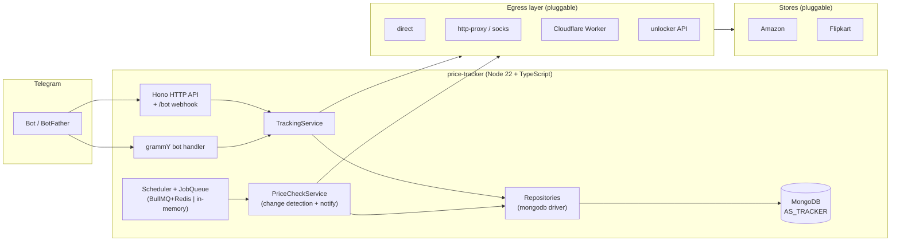

<a href="https://t.me/AsPriceTrackerBot"> </a><br><br>

# [Price Tracker](https://t.me/AsPriceTrackerBot)

A Telegram bot that tracks the price of Amazon & Flipkart products (more coming soon) and notifies
you whenever the price changes.


---

## Features

- Track Amazon products.
- Track Flipkart products.
- Notify on every price change (configurable strategies: every change / only drops / threshold %).
- Broadcast to all users (admin).
- HTTP API with API-key auth.
- Pluggable scraping egress: direct, HTTP/SOCKS proxies, Cloudflare Worker, unlocker API.
- Pluggable stores: adding a third store touches only its own folder + the store registry.

---

## Architecture



- **core/** is DB/library-free: stores, providers and repositories plug in behind ports.
- Telegram webhook in production, long polling in development.
- `worker/` is the Cloudflare Worker counterpart (typed contract, shared secret + host allowlist).

---

## How to use

> To use this bot in your Telegram, [click here](t.me/AsPriceTrackerBot)

- `/start` - Start the bot
- `/help` - get this message
- `/track {Product Link}` - Add product to tracking list
- `/stop_{Tracking ID}` - Stop tracking
- `/list` - Get list of products that are being tracked
- `/broadcast {msg}` - Broadcast to all users (admin)
- `/users` - List all users (admin)
- `/stats` - Show bot statistics (admin)
- `/update` - Trigger an immediate re-check (admin)

---

## Development

Requires **Node 22+** and **pnpm**.

```bash
pnpm install
cp .env.example .env   # fill in BOT_TOKEN, API_KEY, DB_URL, ADMINS
pnpm dev               # tsx watch (long polling)
```

### Scripts

| Command                | What it does                                    |
|------------------------|-------------------------------------------------|
| `pnpm dev`             | Run with `tsx` watch                            |
| `pnpm build`           | Compile `src/` to `dist/` (`tsc`)               |
| `pnpm start`           | Run the compiled `dist/main.js`                 |
| `pnpm typecheck`       | `tsc --noEmit` (strict)                         |
| `pnpm lint`            | ESLint (typescript-eslint strict)               |
| `pnpm format:check`    | Prettier check                                  |
| `pnpm test`            | Vitest (offline, fakes only)                    |
| `pnpm test:coverage`   | Coverage with per-area thresholds               |
| `pnpm circular`        | Madge circular-dependency check                 |
| `pnpm worker:dev`      | Run the Cloudflare Worker locally (wrangler)    |

---

## Environment variables

| Variable                 | Required | Default          | Description                                                              |
|--------------------------|----------|------------------|--------------------------------------------------------------------------|
| `BOT_TOKEN`              | yes      | —                | Telegram bot token from [@BotFather](https://t.me/BotFather)             |
| `API_KEY`                | yes      | —                | Secret key for every API route except `/bot`                             |
| `DB_URL`                 | yes      | —                | MongoDB connection string                                                |
| `ADMINS`                 | yes      | —                | Telegram admin ids, space or comma separated                              |
| `NODE_ENV`               | no       | `development`    | `production` enables webhook mode (no long polling)                       |
| `PORT`                   | no       | `3000`           | HTTP port                                                                 |
| `LOG_LEVEL`              | no       | `info`           | pino level                                                                |
| `DB_NAME`                | no       | `AS_TRACKER`     | MongoDB database name                                                     |
| `LIMIT`                  | no       | `5`              | Max products per user                                                     |
| `TELEGRAM_SECRET_TOKEN`  | no       | —                | Verified on webhook updates                                              |
| `WEBHOOK_URL`            | no       | —                | Production webhook URL (set automatically via `/setup` otherwise)         |
| `AMAZON_AFFILIATE_TAG`   | no       | `asloot-21`      | Affiliate tag appended to Amazon notification links                       |
| `NOTIFY_STRATEGY`        | no       | `every-change`   | `every-change` \| `only-drop` \| `threshold`                              |
| `NOTIFY_THRESHOLD_PERCENT`| no      | `0`              | Percent change required when strategy is `threshold`                      |
| `SCHEDULE_INTERVAL_MS`   | no       | `3600000`        | Re-check interval (hourly, like the legacy bot)                           |
| `SCHEDULE_JITTER_RATIO`  | no       | `0.1`            | Add per-product jitter ±ratio to stagger checks                          |
| `REQUEST_TIMEOUT_MS`     | no       | `15000`          | HTTP timeout for fetches                                                  |
| `REDIS_URL`              | no       | —                | Enables BullMQ queue (in-memory queue used otherwise)                     |
| `EGRESS_CONFIG`          | no       | `direct`         | Egress pools JSON (inline or file path), `\${ENV_VAR}` interpolation       |
| `PROXY`                  | no       | —                | Legacy: scraping proxy URL (`http://` or `socks5://`)                     |
| `WORKER_URL`             | no       | —                | Legacy: Cloudflare Worker URL used for scraping                           |

### Egress configuration

`EGRESS_CONFIG` is JSON describing pools and providers. Provider types: `direct`, `http-proxy`,
`socks`, `cloudflare-worker`, `unlocker-api`. Each provider belongs to a pool, pools are load-balanced
(strategies: `round-robin`, `random`, `weighted`, `least-used`, `sticky-session`) and fall back with
exponential cooldown.

```json
{
  "defaultPool": "default",
  "pools": {
    "default": {
      "strategy": "round-robin",
      "providers": [
        { "id": "direct", "type": "direct" },
        { "id": "proxy-us", "type": "http-proxy", "url": "${PROXY_URL}" }
      ]
    }
  }
}
```

When `EGRESS_CONFIG` is unset, the legacy `PROXY` / `WORKER_URL` shim is used; when neither is set,
requests go out `direct`.

---

## HTTP API

All routes require `Authorization: Bearer <API_KEY>` except `/bot` and `/healthz`.

| Method | Path      | Description                                      |
|--------|-----------|--------------------------------------------------|
| GET    | `/`       | `?userId=` → the user's tracked products         |
| POST   | `/`       | `{url, userId, email?}` → `{ok, tracking_id}`    |
| DELETE | `/`       | `{tracking_id, userId}` → `{ok: true}`           |
| GET    | `/stats`  | `{users, products}` totals                        |
| GET    | `/info`   | `[{id, name, mail}]` (mail trimmed)              |
| GET    | `/setup`  | Point Telegram at this host's `/bot` webhook     |
| POST   | `/bot`    | Telegram webhook                                 |
| GET    | `/healthz`| Liveness probe (no auth)                         |

---

## Deploy

**NOTE** - We're now using a pluggable egress layer for sending requests. Add your proxy URL in env
as `PROXY` (legacy) or define pools via `EGRESS_CONFIG`.

[](https://heroku.com/deploy?template=https://github.com/siddiquiaffan/price-tracker "Deploy with Heroku")

[](https://railway.app/new/template?template=https://github.com/siddiquiaffan/price-tracker&envs=ADMINS,BOT_TOKEN,DB_URL,WORKER_URL,API_KEY,LIMIT&ADMINSDesc=Telegarm+ids+of+admins+separated+by+space&BOT_TOKENDesc=Get+Your+Bot+Token+From+@BotFather.&DB_URLDesc=Create+A+Database+In+Mongodb+And+Get+URL.&WORKER_URLDesc=Paste+worker.js+code+in+Cloudfare+Worker+and+get+url.&API_KEYDesc=Any+secret+key+to+access+API&LIMITDesc=Limit+of+products+to+track+per+user. "Deploy on Railway")

### Docker

```bash
docker build -t price-tracker .
docker run -d -p 3000:3000 \
  -e BOT_TOKEN=... -e API_KEY=... -e DB_URL=mongodb://mongo:27017 \
  -e ADMINS=123456 -e NODE_ENV=production \
  price-tracker
# health check: curl http://localhost:3000/healthz
```

The image runs as a non-root user and only ships `dist/` + production dependencies.

### Heroku

`app.json` + `Procfile` are provided (the build runs via `heroku-postbuild`).

### Cloudflare Worker

The scraping worker lives in `worker/` — see [`worker/README.md`](worker/README.md). It needs the
shared secret and the allowlist configured to match `EGRESS_CONFIG`.

### Local

```bash
git clone https://github.com/siddiquiaffan/price-tracker
cd price-tracker
pnpm install
cp .env.example .env   # fill in your details
pnpm dev
```

### POST-DEPLOYMENT

**Setup bot:** Get your deployment url and navigate to `{YOUR_DEPLOYMENT_URL}/setup`

```
Example: https://price-tracker.herokuapp.com/setup
```

=> Replace `https://price-tracker.herokuapp.com/` with your deployment url.

---

## Contributing

- Fork this repo 
- Add your changes
- Create a pull request

The TypeScript rewrite notes (behaviour catalogue, bug list B1–B25, migration mapping) live in
[`docs/MIGRATION_NOTES.md`](docs/MIGRATION_NOTES.md) and `docs/adr/`.

---

## NOTE

- Do not clone this repo (You can fork it instead)
- Use this bot at your own risk
- This bot can be a little bit slow because of using Cloudflare workers for scraping product data
  (To avoid IP blocking from Amazon & Flipkart)

---

## License

[GPL-3.0](LICENSE) — includes attribution to the original author,
[https://github.com/AffanTheBest](https://github.com/AffanTheBest).